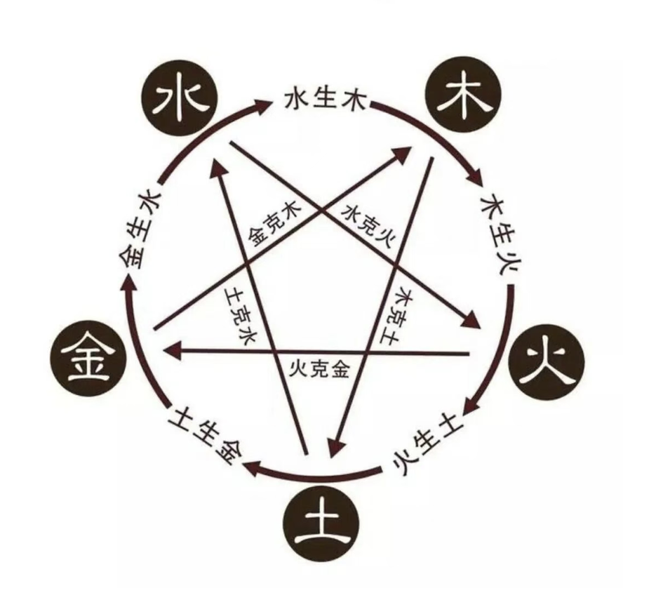

<p align="center">
  
</p>

<h1 align="center">🀄️ 四柱八字 · Reasonix Skill</h1>

<p align="center">
  <strong>一个可安装的 AI 知识库 Skill —— 系统掌握四柱八字命理学</strong>
</p>

<p align="center">
  <a href="LICENSE"></a>
  <a href="#安装方式"></a>
  
  
</p>

---

## 📖 这是什么？

本仓库是一个 **Reasonix Skill** —— 一个封装了完整四柱八字命理学知识的 AI 插件。

知识来源：B站UP主 **易理施**（易学研究小组）的系统课程《四柱八字命理》，通过 OCR 数字化为 135 页、约 33 万字的全文知识库。安装后，AI 助手即获得查阅这本"命理教科书"的能力，可以引用原文回答任何四柱八字相关问题。

> 💡 **Reasonix Skill** 是一种可安装的 AI 知识扩展 —— 就像一个给 AI 装的"专业 App"。装上之后，AI 在相关话题下会自动查阅这个知识库来回答。

---

## 🎯 知识覆盖

<table>
<tr>
<td width="50%">

### 🔰 基础理论
- ☯️ 阴阳五行 · 天干地支
- 🌏 命理学哲学基础（天道/地道/人道）
- 🌌 天文学依据（天体运行与气候变化）
- 📜 发展简史（伏羲 → 李虚中 → 徐子平）

### 🧩 核心体系
- 🎌 **日元** —— 四柱论命核心
- 🏷️ **十神** —— 正官·七杀·正印·偏印·食神·伤官·正财·偏财·比肩·劫财
- 🔗 **刑冲合害** —— 十二地支的六组关系

</td>
<td width="50%">

### 🏰 格局详解
- 正官格 · 七杀格
- 正印格 · 偏印格
- 食神格 · 伤官格
- 正财格 · 偏财格
- 建禄格 · 阳刃格

### 🔮 进阶应用
- 用神 · 喜神 · 忌神 · 调候
- 大运 · 流年推算
- 实战案例解析
- 健康信息分析

</td>
</tr>
</table>

---

## 📦 安装方式

### 方式一：一键安装（推荐）

在 Reasonix 对话框中输入：

```
/install https://github.com/xhzair/sizhu_bazi
```

### 方式二：克隆后本地安装

```bash
git clone https://github.com/xhzair/sizhu_bazi.git
```

然后在 Reasonix 中：

```
/install /path/to/sizhu_bazi
```

### 方式三：直接使用 .skill 文件

下载仓库中的 `sizhu-bazi.skill` 文件，然后在 Reasonix 中：

```
/install /path/to/sizhu-bazi.skill
```

---

## 🧪 效果演示

安装后，你可以直接问 AI：

| 问题 | AI 会怎么做 |
|------|-----------|
| *"什么是日元？怎么判断强弱？"* | 查阅原文第20页起的内容，引用原文回答 |
| *"正官格和七杀格有什么区别？"* | 定位格局详解部分，对比两种格局的特征 |
| *"三合和六合有什么不同？"* | 搜索刑冲合害章节，给出精确定义和例子 |
| *"帮我分析一个八字"* | 结合十神、格局、用神等理论综合分析 |

每次回答都会**引用原文**并标注**来源页码**，就像一位随身携带教科书的命理助教。

---

## 📂 仓库结构

```
sizhu_bazi/
├── sizhu-bazi/               ← Skill 包
│   ├── SKILL.md              ← 技能定义（含使用指南）
│   └── references/
│       └── full_text.txt     ← 135页全文知识库（33万字）
├── sizhu-bazi.skill          ← 打包好的 .skill 文件
├── ocr_output/               ← 逐页 OCR 文本（共135页）
├── ocr_all.py                ← OCR 脚本（PyMuPDF + Tesseract）
├── tessdata/                 ← Tesseract 中文训练数据
├── 五行图.png                ← 五行生克关系图
├── 干支模型.png              ← 天干地支模型图
└── LICENSE                   ← MIT License
```

---

## ⚠️ 声明

- 本知识库内容来源于 B站UP主 **易理施**（易学研究小组）的公开课程，仅供学习研究使用
- 命理学是传统文化的一部分，请以理性态度看待，**仅供娱乐参考**
- OCR 识别可能存在少量文字偏差，AI 使用时已做容错处理

---

## 🙏 致谢

- 课程作者：**易理施**（易学研究小组）
- OCR 引擎：[Tesseract OCR](https://github.com/tesseract-ocr/tesseract)
- PDF 解析：[PyMuPDF](https://github.com/pymupdf/PyMuPDF)

---

<p align="center">
  <sub>Made with 🀄️ for Reasonix · <a href="LICENSE">MIT License</a></sub>
</p>
